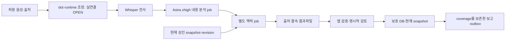

# Runtime 분석·맥락 왕복과 로컬 기반 인수 판정

**최우선 미완료 기능은 실제 runtime 분석과 별도 맥락 추론의 앱 왕복이다.** `integration/major-features-20261026`의 `dc0c16b506065a22a12ffaccf3b267aeeacae1fa`는 **공개 음성 전사·검토 저장·부분 보고의 로컬 기반 데모**로 판정한다. Whisper 전사와 규칙 기반 추출·후보 reducer를 내용 이해·누적 맥락 추론 완료로 세지 않는다. [M1~M6의 완료정의](MILESTONES.md)는 유지하며 이 문서가 최신 상태·우선순위의 보충 기록이다. 진행률과 완료 예정일은 산정하지 않는다.

검토 범위는 고정 commit의 코드와 작성자 원증거 독립 대조다. 이번 설계 검토에서 새 Android/STT/외부 모델 실행은 하지 않았다. 제품코드·공유 SQL·동결 wire·원격 Page는 수정하지 않았고 문서는 `docs/milestones-git`에서 전달한다.

## 원래 목표와 현재 실행의 구분

[설계 Page sequence54](https://chatgpt.com/space/page_257b0a73cf808191a03c02362edc2673)의 블록 `904c78d4-6434-47a1-973f-997e5b9522ef`와 `424f7ddf-9a1d-4479-8d6b-ae01710f7818`에는 앱이 모은 음성·시각·번호를 dot·worker가 분석하고 관련 SMS·네이버 근거와 함께 앱에 반환하는 목표, code33/34 로컬 Whisper는 보조라는 구분이 이미 있다. 목표가 없었던 것이 아니라 실제 호출·반환 연결이 미완료다. 현재 sequence54의 해당 블록을 다시 읽었다. sequence53은 [당시 계약의 baseline](plans/context/integration_contract.json)으로 대조했으며 과거 Page 전체 snapshot을 새로 확보한 것으로 보고하지 않는다.

최신 사용자 요구는 **Whisper = 전사**, **GPT-6 Astra xhigh = 요청·약속·기한·필요서류의 내용 해석과 정리**, **별도 맥락 단계 = 기존 승인 기록과 대조해 갱신 후보 계산**이다. 맥락 단계 모델은 분석 단계 모델 지정과 구분해 실행 계약에서 확정한다. dot의 조정 역할을 다른 실행 서비스로 바꾸는 결정은 부모가 명시적으로 다룬다. 로컬엔진을 늘리는 방식으로 원래 목표를 조용히 대체하지 않는다.

후속으로 확정된 사용자 요구는 **이음 안의 ChatGPT 로그인 진입→공식 인증 후 앱 복귀→첫 실행 권한 안내/녹음 폴더 선택→허용된 자료 분석→결과파일을 기기에 저장·검토**다. 이에 대한 주 구현 제안은 아래 **SIWC와 Android 로컬 runtime의 두 단계 추론 호출**이다. 이는 개인 dot 중계와 다른 실행 배치임을 명시하며, 원래 개인 dot 자동 수신/조정은 별도 OPEN으로 보존한다. 기존 계정으로 공개/합성 시험은 허용됐지만 새 등록·OAuth grant/지속 접근·키·유료 계약·실제 개인정보 전송을 함께 승인한 것은 아니다.

| 대상 | `dc0c16b`에서 실제 확인한 것 | 확대 해석 금지 |
| --- | --- | --- |
| 개발 worker | 기능 branch를 작성·시험하는 Codex 작업 대화 | 녹음마다 앱이 호출하는 runtime 서비스가 아님 |
| Android 로컬 분석 | `AndroidWhisperRunner`의 JNI 전사, 첫 문장 추출·키워드 기반 확인 필요 TODO | Astra/high/dot 의미 추론 아님 |
| 맥락 모듈 | 정규화된 Claim을 받는 Kotlin reducer; 통합 adapter는 인용된 TASK/NEEDS_CONFIRMATION만 전달 | 자연어에서 서류판·기한·취소·부분 이행을 해석하는 별도 모델 호출 아님 |
| 기존 `worker/` | Node `ProcessingEngine`의 STT→SUMMARY, HTTP provider와 보호된 결과 조회 코드 | 배포·계정 연결·실제 모델 실행 증거 아님. 별도 맥락 job 없음 |

코드 근거: [AndroidWhisperRunner](https://github.com/bllue583-commits/ieum-app/blob/dc0c16b506065a22a12ffaccf3b267aeeacae1fa/android/app/src/main/java/kr/callbrief/AndroidWhisperRunner.kt), [IntegratedContextStore](https://github.com/bllue583-commits/ieum-app/blob/dc0c16b506065a22a12ffaccf3b267aeeacae1fa/android/app/src/main/java/kr/callbrief/IntegratedContextStore.kt), [engine](../worker/src/engine.mjs), [provider](../worker/src/providers.mjs), [Android API port](../android/app/src/main/java/kr/callbrief/AutomationApiProcessingPort.kt). Node SUMMARY는 기존 요약·할일을 한 요청에 포함하지만 두 독립 추론 단계는 아니다. 현재 body에는 `reasoning.effort`가 없고 실행 결과의 model 필드도 설정값을 사용한다. `dotInvoked:false`, `driveResultWritten:false`, `canonicalWriteAllowed:false`는 그대로 유효하다.

## 플랫폼 지원 판정과 신규 왕복 담당에 전달할 계약

공식 공개 문서와 현재 노출된 도구의 **명세**만 확인했다. 계정의 entitlement, token, 실제 배포 endpoint, 실행 모델/effort는 확인하지 않았고 신규 인증·유료 호출·음성 업로드를 수행하지 않았다. 아래의 미확인은 불가능 판정이 아니다. SIWC는 자격 있는 사용자의 ChatGPT 플랜 사용을 별도 동의로 지원하므로 별도 API 키/결제를 필수라고 단정하지 않는다.

| 경로 | 지원 판정과 근거 | 이음에서 남은 연결 |
| --- | --- | --- |
| Android→SIWC→플랜 추론 | **공식 public-client/Responses 경로 지원.** identity 로그인과 플랜 사용 scope는 별개. OSS 및 선택된 Private client 범위이며 이음 등록·Android 적합성은 미확인 | 아래 정확한 계약으로 구현. account catalog의 Astra 가용성·xhigh 실응답, loopback callback/앱 복귀, 새 grant 필요 여부 확인 |
| 앱→개인 dot 원음 자동 수신 | **미확인.** [dots 문서](https://learn.chatgpt.com/docs/dots)는 ChatGPT 내 대화·통화 사용을 설명하지만 Android 앱의 임의 WAV 업로드 및 처리 영수증 계약을 제시하지 않음 | 실제 접근 가능한 수신 endpoint/권한/bytes 수신·hash 검증/실행 trigger를 각각 입증 |
| 게시된 Workspace Agent 호출 | **텍스트 trigger 지원.** `POST https://api.chatgpt.com/v1/workspace_agents/{id}/trigger`, 문자열 `input`, 선택적 `conversation_key`, 재시도용 `Idempotency-Key`. `{id}`는 게시된 API 채널 ID이며 개인 dot ID라고 가정하지 않음 | 공개 API 채널의 실제 존재·권한, 음성 materialization, 두 단계 역할/모델 선택 검증 |
| Workspace Agent 결과 회수 | **이 trigger API의 응답 본문 회수는 미지원.** `202`와 beta run status의 `completed`는 실행 상태이며 앱 결과파일이 아님 | 별도 허용 writer·저장소·앱 회수 계약 필요. conversation URL을 결과파일로 사용하지 않음 |
| Astra xhigh 분석 호출 | **OpenAI API에서 지원.** `POST https://api.openai.com/v1/responses`, `model: "gpt-6-astra"`, `reasoning: {"effort":"xhigh"}`. Astra의 직접 audio 입력은 미지원이므로 전사와 출처를 입력 | 서버 adapter, 실제 권한·비용 범위, 응답 검증·실행 영수증·결과파일 연결. API 지원이 이음 계정의 접근 확인을 뜻하지 않음 |
| 별도 맥락 추론 job | **기본 모델 호출 수단은 지원, 이음 두 단계 orchestration은 미구현.** 같은 호출을 두 역할로 나누는 것은 제안이며 현재 완성 기능 아님 | 별도 실행 ID, 분석 출력 hash와 승인 snapshot 결속, 검토 가능한 delta 및 오래된 응답 거절 |
| Codex SDK 경로 | **로컬 agent의 프로그램 실행·최종 응답 수신 지원.** 개인 dot의 자동 음성 수신과 동일 기능은 아님 | 사용 가능 모델·설정·격리·권한·상시 운영 및 이음 연결 검증. 개발 thread ID를 운영 endpoint로 사용하지 않음 |
| 현재 합성 연결 플러그인 | **고정 fixture 도구만 노출.** `create_synthetic_audio_job`/`get_synthetic_audio_file`은 등록된 `synthetic-voice-en-a`/`synthetic-audio-job-v1` WAV의 큐 저장·bytes/SHA 읽기 명세. STT/요약은 실행하지 않음 | 일반 음성·실통화 수신, 자동 분석, 음성 결과 writer 미확인. `save_demo_result`는 `synthetic-job-v1` 텍스트 draft에만 해당 |

공식 근거: [Workspace Agent trigger와 결과 제한](https://learn.chatgpt.com/workspace-agents/trigger-runs), [workspace 전용 token·관리자 설정](https://learn.chatgpt.com/workspace-agents/authentication), [Astra model/effort·입력 형식](https://developers.openai.com/api/docs/models/gpt-6-astra), [Codex SDK의 서버 실행·응답](https://learn.chatgpt.com/docs/codex-sdk). Workspace token과 OpenAI API credential을 교환 가능한 것으로 취급하지 않는다. 이 검토가 새 token/권한 발급을 승인하지 않는다.

### SIWC: 이음 내부 로그인부터 기기 결과파일까지의 구현 계약

다음은 공식 protocol과 이음에 적용할 **구현 제안**을 구분한 계약이다. endpoint는 공식 문서에서 확인했고 제품코드에는 아직 적용하지 않았다. [SIWC quickstart](https://developers.openai.com/siwc/quickstart)는 OSS와 선택된 Private client를, [개요](https://developers.openai.com/siwc/token-sharing-open-source)는 로컬 앱 경로를 설명한다. 이 저장소를 공개하거나 partner 신청·약관 수락·새 client 등록을 실행하지 않았다. Private 이음의 실제 admission은 검증 게이트로 남긴다.

| 단계 | 정확한 protocol 또는 기존 코드 | 이음에서 구현할 행동·종료 조건 |
| --- | --- | --- |
| 시작 주체 | Android 이음의 사용자가 누르는 로그인/분석 명령 | 기기 로컬 runtime이 job을 시작한다. 승인 전 백그라운드 모델 호출0; 추후23시/06시 처리는 별도 명시적 background 동의와 동일 gate 사용 |
| 첫 실행 폴더 | `MainActivity.pickFolder/selectRecordingFolder`, `ACTION_OPEN_DOCUMENT_TREE`, `takePersistableUriPermission(READ)`, `SafSelectedRecordingSource.checkSelected` | 기존 온보딩 결정을 유지한다. 필요한 최소권한·폴더 읽기를 안내하고 거절 시 기존 선택 보존, 철회/재시작 시 grant 확인. 선택 폴더 밖 열기0. 폴더 권한과 분석 전송 동의를 분리 |
| 목록/bytes | `SelectedRecordingSource.inventory/stat/checkReadable/open`, `SourceInventory.complete`; 읽기 전 제외·owner/policy 확인 | 실제 document ID/URI는 기기 내부에 보존. 목록 manifest는 source ID/version, MIME/bytes/modified, 원 발생시각 또는 미상, audio SHA, 선택 revision·권한/정책 epoch, inventory completeness를 결속. metadata 전후 변경·partial/virtual·제외는 보류. 전사/분석에 필요한 명시 범위만 선택 |
| 전사 | Android JNI Whisper, 현재 PCM16 mono16k WAV/10MiB | bytes는 이 단계에서 기기 안에 실제 materialize·hash 검증. SIWC에 원음을 업로드하지 않음. 전사 SHA·구간·source pack을 생성하고 원문/목록 전체를 일반 로그에 쓰지 않음 |
| 추론 | `GET https://api.openai.com/v1/models`; `POST https://api.openai.com/v1/responses` | 동일 SIWC access token으로 계정별 `models[].slug` 확인. Astra가 없으면 명시적 blocker, 하위 모델로 조용히 대체하지 않음. 분석과 맥락은 별도 요청·job. SSE의 `response.completed`와 schema/근거 검증을 모두 통과해야 성공 |
| 기기 결과 저장 | 제안 위치: `context.noBackupFilesDir/runtime-analysis-v1/<scope>/<jobKey>/` | source manifest·분석·맥락·receipt를 각각 암호화 파일로 저장. `<scope>`는 기존 owner 경계와 SIWC 등록 결속, `<jobKey>`는 허용 문자 digest. raw URI/이메일을 경로로 쓰지 않음. 아래 원자성/복구 계약 적용 |

**인증 protocol:** 시스템 브라우저의 `https://auth.openai.com/api/accounts/authorize`에 처음에는 `client_id=dynamic_agent_client`, `agent_name_hint=이음`, 안정적인 `ext_agent_host_id`, `response_type=code`, `resource=https://api.openai.com/v1`, scope `openid profile email offline_access resource.invoke chatgpt.tokens.use.direct`, 매 시도 새 `state/nonce/PKCE-S256`를 전달한다. callback은 `http://127.0.0.1:<선택포트>/auth/callback`이며 listener를 먼저 연다. code 교환은 `POST https://auth.openai.com/api/accounts/oauth/token`에 `grant_type=authorization_code`, **반환된 issued client ID**, code/verifier·동일 redirect/resource를 form으로 보낸다. secret은 없다. state, ID token의 JWKS 서명/issuer/audience/expiry/nonce, 실제 granted scope를 검증한 뒤 활성 계정을 바꾼다. 기존 계정 재인증은 issued ID/host ID를 재사용한다. 이는 [공식 public-client 계약](https://developers.openai.com/siwc/token-sharing-open-source/sign-in)이며 Android 전용 SDK·custom-scheme callback 지원을 뜻하지 않는다. Android에서 브라우저로 전환된 동안 listener 생존·callback 후 앱 복귀는 실제 시험이 필요한 B02다.

**인증 주체/수명:** 사용자가 선택한 SIWC 등록/검증된 subject와 issued client ID를 함께 분리 보관한다. Google owner나 이메일을 ChatGPT 계정/워크스페이스의 동일 신원으로 추정하지 않는다. 공식 수명은 access1시간, refresh30일/갱신시 rotation이며 실제 응답 expiry를 저장한다. 기기 보호 저장소에서 토큰·expiry를 원자적으로 함께 교체하고 refresh는 같은 세션당 하나만 실행한다. 앱 재시작은 새 client 등록이 아니다. 로그아웃은 신규 호출/commit을 막고 공식 discovery의 revocation endpoint를 사용하며 미확인 원격 철회와 로컬 종료를 구분한다. [세션·갱신](https://developers.openai.com/siwc/token-sharing-open-source/profiles-and-sessions), [token 수명](https://developers.openai.com/siwc/token-sharing-open-source/token-reference). 토큰은 사용자 제어의 보호 로컬 저장에만 두고 Git/로그/원격 관리 서버로 복제하지 않는다. background 사용에는 별도 명시 동의가 필요하다. [SIWC 운영 조건](https://openai.com/policies/sign-in-with-chatgpt-terms/)

**SIWC 요청 규격:** `Authorization: Bearer <SIWC access token>`, `Content-Type: application/json`; `model="gpt-6-astra"`, `reasoning={"effort":"xhigh"}`, `store=false`, `stream=true`, `input`은 필요한 source pack을 담은 배열, 정책은 `instructions`에 둔다. 기존 Node body의 문자열 input·`max_output_tokens`를 그대로 재사용하지 않는다. `background`, `conversation`, `previous_response_id`, `metadata`, `multi_agent`도 이 HTTP 경로에 넣지 않는다. **audio/video·Files 업로드·transcription API는 SIWC 미지원**이다. 지원 모델의 text/image/file 입력과 파일 업로드 API 지원을 혼동하지 않는다. [SIWC 추론](https://developers.openai.com/siwc/token-sharing-open-source/models-and-inference), [preview 제한](https://developers.openai.com/siwc/token-sharing-open-source/preview-limitations). account catalog 확인과 실제 Astra/xhigh 응답은 B03이며 아직 실행0이다. 플랜의 앱별 한도와 credits 사용은 사용자가 ChatGPT Settings > Usage에서 제어한다. 한도 초과 시 추가 유료 API/credits 경로로 자동 전환하지 않는다. [플랜 사용·한도](https://learn.chatgpt.com/docs/sign-in-with-chatgpt)

**분석 JSON과 맥락 입력:** 분석은 [기존 worker-output.schema.json](../android/call-core-android/src/main/assets/worker-output.schema.json)의 6개 top-level 필드/claim 구조를 기본 계약으로 삼는다. `claims`는 요청·날짜·서류·상태 등을 각 `claim_id/category/subject_id/value/certainty/evidence/status/assignee/due/due_expression/replaces`에 표현하고 근거는 `source_id/start/end/quote`의 Unicode code-point 구간이다. 분석 결과와 현재 승인 snapshot을 별도 맥락 job에 전달해 기존 task/document target을 대조하고 delta/hold/conflict로 정규화한다. `WorkerV1Boundary`는 현재 **synthetic 단일 source·execution_observed=false만 허용**하므로 실제 Astra 결과를 통과시키려고 거짓 synthetic 표시를 넣지 않는다. 구조 validator 재사용과 native provenance/현재성 adapter 확장은 다른 작업이다. 여러 source의 맥락 결과를 이 단일-source gate로 곧바로 저장할 수 있다고 가정하지 않는다. 맥락 담당과 core가 이 adapter 매핑부터 고정한다.

**job/중복/취소:** 보호 journal의 논리 key는 owner·source/version/audio SHA·stage·input SHA·base snapshot revision·요청 model/effort를 포함한다. 접수/전사/분석요청/분석완료/맥락요청/맥락완료/파일보관/검토대기를 단계별 commit한다. 같은 key의 완료 단계는 재호출하지 않고 원 receipt를 읽는다. 전송 직전에는 current owner·정책·grant·취소 epoch를 재검사한다. SSE 중단·앱 crash로 completion을 모르면 **UNKNOWN**을 보존하며 자동 재호출하지 않는다. 이 SIWC route의 서버 멱등 키·완료 뒤 조회 API는 확인하지 못했으므로 exactly-once 모델 호출/과금이나 서버 cancel을 약속하지 않는다. 취소는 로컬 중단·스트림 종료와 이후 저장 fencing을 수행하고 원격 실행 중단 확인 여부를 별도로 남긴다. 명시적 재시도는 원 attempt를 보존한 새 attempt로 기록한다.

**결과파일/DB 원자성:** 제안 파일은 `manifest.json.enc`, `analysis.json.enc`, `context.json.enc`, `receipt.json.enc`다. 기존 보호 저장 primitive로 임시 ciphertext를 같은 디렉터리에 쓰고 flush/fsync→`AtomicFile.finishWrite` 또는 검증된 동일 filesystem 원자적 교체→재읽기/AEAD·SHA 확인 뒤 DB transaction에서 pointer/hash·stage를 확정한다. 파일과 DB 전체를 하나의 원자 transaction이라고 주장하지 않는다. 파일 후 DB 전 crash는 orphan 검증·재연결, DB pointer 뒤 파일 불일치는 hold다. 기존 승인본을 덮어쓰지 않고 불변 revision을 만든다. 평문 export·공유 Downloads·외부 서비스 writer는 이 SIWC 직접 경로에 필요 없다. 파일 재읽기 후 native binding/현재성→명시 검토→보호 DB 승인 snapshot에 연결하며 결과파일 receipt는 사용자 승인 receipt를 대신하지 않는다.

**실패복구:** consent 거절·plan scope 없음은 identity 로그인과 구분해 분석 불가. 새 계정 전환은 이전 job commit 금지. 403 eligibility/unsupported route는 동일 요청 반복0, 429는 플랜 사용을 멈추고 실제 오류/사용량 화면을 제시, 일시503은 제한 backoff·credential 보존. refresh rotation 오류는 공식 코드에 따라 재인증하며 일반 네트워크 실패만으로 계정을 지우지 않는다. SSE delta가 있어도 failed/incomplete/종료 이벤트 누락이면 최종 파일·canonical 적용0이다. [공식 오류·복구](https://developers.openai.com/siwc/token-sharing-open-source/errors-and-recovery)

| 인수 입력/실험 | 기대 출력/실패 조건 | 실행 상태 |
| --- | --- | --- |
| T-SIWC01 기존 사용자 계정·허용된 등록 | 공식 callback/state·issued client·ID 검증, plan scope, catalog. 거절/다른계정 callback은 활성 토큰 교체0 | NOT_RUN: 새 grant/Private admission 및 Android callback B01/B02 |
| T-SIWC02 공개 한국어 WAV 1건 | 실제 JNI 전사 receipt→Astra xhigh completed·인용 검증→별도 맥락 completed→암호화 파일 재읽기→검토 대기. 수동 검토 전 canonical 승인0 | NOT_RUN: B01~B04 |
| T-SIWC03 합성 연속 대화 | A(2026-10-26 10:00 KST): “신청서와 재직증명서를 금요일까지 보내주세요.” B(2026-10-28 11:00 KST): “재직증명서는 받았고 신청서만 다음 주 월요일까지 부탁해요.” 같은 합성 업무를 명시 결속. 신청서 기한 후보는 10-30→11-02, 증명서는 수신 후보. 발언만으로 수동 DONE를 만들지 않음 | NOT_RUN: 새 합성 음성 fixture 필요; 참조 정답을 모델 입력에 섞지 않음 |
| T-SIWC04 취소·오프라인·재기동·동일 job | 전사/완료된 추론 재실행0, 불명 attempt 자동재시도0, 취소/오래된 owner·revision 저장0, 원 파일/receipt 보존 | NOT_RUN; transport fault 주입과 실제 실행을 따로 보고 |
| T-SIWC05 조작·거절·limit | source hash/quote/스키마 불일치·failed/incomplete·429에서 승인/최종 성공0, 토큰/원문 로그0. 규칙 검증 PASS를 의미 이해 PASS로 세지 않음 | NOT_RUN; 네트워크 fake만 쓴 경우 MOCKED 표기 |
| T-SIWC06 폴더 권한 거부/철회·범위밖 파일·목록부분 | 기존 선택 유지 또는 연결필요, 범위밖 bytes0, 목록 전체 완료로 표시0. 폴더 권한만으로 외부 전사 전송 시작0 | 기존 회귀를 재사용·신규 SIWC 접점 회귀 NOT_RUN |

현재 blocker는 **B01 Private 이음 등록/기존 사용 가능 grant 확인**, **B02 Android loopback·앱 복귀**, **B03 계정별 Astra/xhigh 실제 허용·완료 응답**, **B04 실제 실행 영수증→기존 저장 adapter**다. denied 또는 이미 성공한 호출이 아니라 **미실행/미확인** 상태다. 다음 단계는 신규 담당이 인증·SSE·결과파일 contract를 구현하고 B01~B04를 순서대로 검증하는 것이다. 기존 계정테스트 허용을 활용하되 새 OAuth 동의가 필요하면 이음 이름·scope·로컬 token 보관·플랜 사용/한도·공개 합성 전사 입력을 제시해 부모가 승인 절차를 진행한다. 별도 API key 경로는 자동 fallback이 아니며 해당 credential/비용이 따로 허용될 때만 검토한다.

원음 bytes를 외부 분석 runtime에 직접 전달하는 것이 필수라면 **SIWC 단독 경로는 그 요구를 충족하지 않는다.** 여기서 제안한 것은 앱이 음성을 실제 읽고 전사한 뒤 Astra가 내용을 해석하는 경로다. 원음 자체의 외부 수신이 필요한 dot/전사 서비스 경로는 별도 지원·권한·데이터 전달 계약을 확인하며 원음 업로드 완료로 표시하지 않는다.

**즉시 구현 배치:** 부모가 생성한 `feature/astra-audio-roundtrip`, 담당 `01a177e0-5d8a-72dc-831d-884f96b5a033`, base `dc0c16b`가 실제 호출 경로 선택·분석 실행·결과파일/앱 readback을 소유한다. 아래는 아직 구현되지 않은 논리 계약이며 새 URL·wire 필드를 발명하는 지시가 아니다.

1. **접수:** owner/source ID/version/audio SHA·bytes, 원 발생시각 또는 미상, 제외·권한/정책 epoch를 결속한다. 변환 시 원음 hash와 decoded/chunk hash를 분리한다. 승인된 bytes를 실제 수신·검증했다는 영수증 없이는 RECEIVED를 만들지 않는다.
2. **전사:** 실제 STT 엔진·모델 pin, 원음/전사 hash, 구간 또는 code-point 위치와 원 응답 출처를 남긴다. 고정 전사 fixture를 실제 음성인식 결과로 보고하지 않는다.
3. **내용 분석:** 요구 모델은 Astra xhigh다. 전사·날짜/시간대·출처는 untrusted data로 전달하고 요청·약속·기한·서류·불확실성을 인용 근거와 함께 구조화한다. 분석 job ID, 요청 model/effort, provider request ID, 응답의 실제 model, 입출력 hash를 기록한다. 응답이 보고하지 않는 effective effort는 `NOT_REPORTED`로 두며 요청값과 관측값을 혼합하지 않는다. 거절·잘림·실패·응답 불명은 성공 후보로 바꾸지 않는다.
4. **맥락 추론:** 분석 출력 hash와 현재 허용 snapshot/hash, source·user/task/board/link/archive revision을 입력으로 결속한 별도 job을 실행한다. 현재 기록의 요청→기한 정정→취소/일부 이행과 서류 상태를 대조해 delta/보류/충돌·근거를 반환한다. 두 단계 호출을 한 summary 요청이나 순수 reducer PASS로 대체하지 않는다.
5. **파일 반환:** 원 job/result ID·owner·출처·base revision·분석/맥락 실행을 결속한 결과를 내구성 저장하고 앱이 같은 hash의 bytes를 읽었음을 확인한다. 기존 frozen 6필드 `schema_version/job_id/source_pack_sha256/base_revision/summary/claims`와 v0/RO1/SG는 유지한다. 새 내부 실행 영수증은 외부 wire에 임의 삽입하지 말고 기존 타입 매핑과 검증 경계를 먼저 합의한다.
6. **앱 적용:** 실제 파일 수신·모델 성공은 사용자 승인 권한이 아니다. native 검증→현재성/취소/owner 검사→명시적 관계·내용 검토→기존 보호 transaction→승인 snapshot 순서를 유지한다. DONE·메모·잠금·숨김·보관은 보존하며 후보의 `canonicalWriteAllowed=false`를 모델 출력으로 바꾸지 않는다.

**왕복 인수:** 공개/합성 음성의 실제 STT→Astra xhigh 분석 응답→별도 맥락 응답→결과파일→Android bytes 검증·보호 저장·재열람까지 같은 source/job lineage를 잇는다. 단순 제목 한 줄 대신 복수 사건의 요청 생성·기한 정정·서류 부분 수신/취소를 기대 상태와 대조한다. duplicate·재시작·응답 UNKNOWN·stale revision·철회·취소를 재현하고 재과금/중복 파일/중복 canonical 적용을 구분한다. 실제 호출 전에 허용 데이터·endpoint·credential 종류·비용 상한·결과 목적지를 구체화하고 부모가 기존 승인 범위와 대조한다. 미승인 호출을 mock으로 바꿔 실행 인수를 닫지 않는다.

## 로컬 기반 데모에서 인정하는 증거

검토 대상은 [작성자 통합 기록](https://github.com/bllue583-commits/ieum-app/blob/dc0c16b506065a22a12ffaccf3b267aeeacae1fa/docs/INTEGRATION_20261026.md)과 아래 원결과다. 작성자 checkout HEAD/clean 상태와 고정 commit의 코드를 대조했고 집계 JSON만 신뢰하지 않고 JUnit XML·lint XML·실행 로그·두 공개 JSON·APK 내부 pin을 읽었다. 서로 다른 실행의 PASS를 합산하지 않는다.

| 증거 | 독립 대조 결과 | 남는 한계 |
| --- | --- | --- |
| 최종 앱 XML | 77 suites, 고유1095건 = PASS1091/SKIP4, 실패·오류0 | 작성자 실행을 재집계한 것. SKIP4는 기존 T81~T84 합성 WAV 미준비 |
| 맥락/core XML | 맥락 2 suites/44 PASS, core 3 suites/27 PASS | 모듈의 결정론·규칙 검증이며 고급 모델 의미 인수 아님 |
| 최종 빌드·lint | 로그 BUILD SUCCESSFUL, APK 3종 빌드 기록; lint Fatal0/Error0/Warning35 | 신규 독립 Android 빌드 실행 아님 |
| 실제 AOSP35 ARM64 원 JSON | JNI2; 분석/관계결속 후 사용자 내용검토0; 별도 내용승인 후 검토2. 일일/7일 r1 보고·outbox 각2 | 공개 합성 sandbox·명시된 합성 사람/업무/시각이며 일반 음성 수집 아님 |
| 프로세스 재개 JSON | PID2455→2579, 추가 JNI0, 같은 outbox ID·durable cursor·검토2 | force-stop 후 명시적 시험 재개. OS의 실제 06시/휴면/재부팅 운영 증거 아님 |
| APK/pin | 설치본=debug SHA 아래 값. arm64-v8a/x86_64 JNI와 모델의 bytes/hash가 APK runtime pin과 일치 | 실행은 ARM64 debug만. x86 및 validation APK runtime NOT_RUN |

debug/설치 APK는 41,661,592 bytes, SHA256 `31b4946e6e4c3f7d75254e09b7ef8b1e514bba9d96b1ba0020fff0c920e9b138`; validation APK는 38,523,290 bytes, SHA256 `523f2588ca0d3f559585fc3627b3a97142bf74fdd49da0fad5dac8ff86da50de`다. P3302/P3303 및 공개 host Whisper 미분류 저장/재개 시험은 최종 XML에서 SKIP이 아님을 확인했다. Node29·Python adapter3/SKIP2는 작성자 보고이며 이 검토에서 원결과를 재집계하지 않았다. 설계 validator12/18과 실제 맥락30/보고40 제품 시나리오는 별개다.

원결과는 작성자 checkout의 `evidence/integration-final-results.json`, `evidence/integration-final-full-2.log`, `evidence/integration-device-final/summary.json`, `evidence/integration-device-final/public-evidence/{INITIAL,PROCESS_REOPENED}.json`, `android/{app,context-reconciliation,core}/build/test-results/`다. 이들은 ignore된 로컬 증거이며 Git clone에 들어 있지 않다. 부모가 재검토할 때 해당 고정 증거를 함께 보존해야 한다. 설계 담당의 재집계/해시 기록은 자기 checkout의 `evidence/design-acceptance-review.json`에 둔다.

**승인·완료 의미:** 분석→관계 결속→내용 승인은 서로 다른 단계이고 관계 결속만으로 요약을 승인하지 않는다. `USER_REVIEW_SUMMARY`와 native binding을 대조해 승인 snapshot을 읽는 제한된 연결은 인정한다. `LocalReviewedMorningSync.COMPLETE`의 범위는 원 JSON 그대로 `LOCAL_REVIEWED_STORE_ONLY_NO_EXTERNAL_COLLECTION`이다. 이는 외부 음성·SMS·네이버 수집 완료가 아니다. 보고 coverage는 **PARTIAL**, delivery는 **DRY_RUN_RECORDED**, 외부 발송0이다. 보고 now는 `2026-10-01T21:00:00Z`를 주입한 06KST 시험이며 실제 정각 실행은 OPEN이다.

## 이번 독립 검토에서 남긴 결함·정책 공백

아래 G01/G02는 소스 경로에서 확인한 공백이며 새 기기 실패를 실행해 재현한 것은 아니다. 작성자 전체 시험 PASS는 이 반례를 종료하지 않는다. 구현 담당이 재현→수정→같은 반례 회귀를 맡는다.

| 항목 | 근거와 영향 | 담당·종료 조건 |
| --- | --- | --- |
| G01 통합 처리 중단 대상 오류 | `AndroidLocalSttActivity`의 중단 버튼은 `pilot?.cancel()`만 호출하지만 통합 작업은 `integrationPilot`을 사용한다. onDestroy는 둘 다 취소하므로 닫기와 별개다. 기존 기기 시험은 pilot 직접 호출이며 버튼 회귀가 아님 | 기존코어 단독 writer. 통합 분석/검토 중 실제 버튼 취소를 재현하고 활성 작업을 취소한다. 취소·commit 경계와 이후 저장 여부를 시험하며 CP08의 강한 취소 전체가 해결됐다고 확대하지 않음 |
| G02 확인된 빈 창이 증분 큐를 막을 수 있음 | `LocalReviewedMorningSync`는 `!fullyReviewed`이면 ACCEPTED. `DailyReportInput.fullyReviewed`는 비어 있지 않은 sources를 요구하므로 정상 `NO_RECORDINGS` 창도 완료하지 못한다. `MorningReportRepository.syncRequest`는 가장 오래된 ACCEPTED의 고정 ID/window를 우선하고 ACCEPTED는 attempts를 소모하지 않아 새 창 진행이 막힐 수 있음 | 보고 담당+core adapter 단독 writer 합의. 실제 source port로 빈 창→다음 창 새 자료→재개를 재현. 확인된 로컬0건 checkpoint, DB unavailable/수집 미확인/검토 대기를 구분하고 새 창을 막지 않되 coverage를 전체 COMPLETE로 올리지 않음 |
| G03 취소 후 재활성화·오래된 날짜 정책 | 기존 시험 `disableDuringSnapshotFencesCommitAndOldGenerationCannotResume`는 재활성화 뒤에도 같은 key가 CANCELLED로 남음을 명시한다. 이는 현재 의도된 보호 정책이며 신규 실패로 세지 않음. 자동 보완은 최근7일, 그 이전은 수동 경로가 필요 | 보고 담당. 취소된 날짜를 유지할지 명시적 재개 명령으로 새 revision을 허용할지 계약 결정. 오래된 generation/ACK/UNKNOWN의 무단 부활 금지, 원 이력 보존 |

G01 근거: [Activity](https://github.com/bllue583-commits/ieum-app/blob/dc0c16b506065a22a12ffaccf3b267aeeacae1fa/android/app/src/main/java/kr/callbrief/AndroidLocalSttActivity.kt). G02/G03 근거: [LocalReviewedMorningSync](https://github.com/bllue583-commits/ieum-app/blob/dc0c16b506065a22a12ffaccf3b267aeeacae1fa/android/app/src/main/java/kr/callbrief/LocalReviewedMorningSync.kt), [MorningReportRepository](https://github.com/bllue583-commits/ieum-app/blob/dc0c16b506065a22a12ffaccf3b267aeeacae1fa/android/app/src/main/java/kr/callbrief/MorningReportRepository.kt), [DailyReportContract](../android/app/src/main/java/kr/callbrief/DailyReportContract.kt), [MorningReportRuntimeTest](https://github.com/bllue583-commits/ieum-app/blob/dc0c16b506065a22a12ffaccf3b267aeeacae1fa/android/app/src/test/java/kr/callbrief/MorningReportRuntimeTest.kt). 현재 `knownEmptyAndUnknownEmptyHaveDifferentMeaning`은 fake sync의 COMPLETE를 사용하므로 실제 로컬 adapter의 빈 창 종료를 입증하지 않는다.

## M1~M6 현재 판정과 다음 큰 기능 배치

| 이정표 | 인정하는 기반 | 미완료 종단 게이트 |
| --- | --- | --- |
| M1 실제 분석→업무 저장 | 공개 JNI 전사→인용 후보→명시 관계/내용 검토→보호 저장·재열람 | **최우선:** 실제 Astra xhigh 분석·별도 맥락 추론·결과파일/앱 왕복. 일반 녹음·dot 자동 수신·고급 의미 인수 OPEN |
| M2 누적 맥락 갱신 | reducer44 및 TASK/NEEDS_CONFIRMATION의 제한된 저장 bridge | 두 개 이상 사건의 요청·기한·서류판·취소·일부 이행에 대한 실제 추론→검토 delta→canonical 갱신·기존 화면 일치 |
| M3 자동 수집·복구 | 로컬 checkpoint·보고 장부·프로세스 재개 증거 | 외부 collector cursor, 지원 실제 포맷/긴 음성, OS23시/증분/휴면/재부팅; G01/G02와 CP08 경계 |
| M4 SMS·네이버 | 기존 adapter/합성 계약·미연결 표시 | 실제 허용 수집→맥락 근거→업무 갱신. 네이버는 종합의 필수 의존성 |
| M5 06시 보고·발송 | 주입 시계의 일일/최근7일 PARTIAL·dry-run outbox | 실제06시 운영, 채널 coverage, 응답불명 복구, 서비스 ACK·수신. 카카오는 선택 출력 |
| M6 S25·인계 | Mac Git·고정 APK/모델·AOSP35 ARM64 제한 증거 | 물리 S25, 실제 SAF/OEM 권한·포맷·OS·재열람, Windows 재빌드. 실자료/실계정은 별도 범위 |

1. **실제 runtime 왕복 먼저:** 신규 왕복 담당이 지원 경로·두 job·writer/readback을 구현한다. 맥락 담당은 분석 출력→현재 snapshot→delta 계약을 맡고, 기존코어는 앱 검증·보호 저장을 연결한다. 실제 모델 호출 권한이 열리기 전에는 계약/실패·UNKNOWN 회귀까지 진행하되 runtime 성공은 OPEN으로 둔다. G01/G02는 이 기반의 취소·진행성을 위해 병렬로 닫는다.
2. **누적 업무 갱신:** 실제 분석 출력을 기존 사람/회사/업무와 연결하고 안정적인 기존 task/document identity에 delta를 적용한다. 현재 `${request}:task-i`의 새 TASK만으로 여러 통화의 동일 약속을 통합했다고 보지 않는다. 반복 요청·기한 정정·서류 부분 수신·취소·늦은 과거 입력에서 근거와 현재 상태를 비교하는 종단 회귀를 우선한다. 새 화면보다 이 저장/재열람 연결이 먼저다.
3. **실제 포맷·긴 통화·자동 접수:** 현재 `UnclassifiedAudio`는 명시적 합성 scope/허용 hash, 로컬 decode는 PCM16 mono16k WAV와 10MiB 한도다. AAC/M4A, 긴 통화의 chunk/재개, 구간 hash와 전체 transcript 순서, 재수집/중복/철회 회귀를 공개·합성 자료로 구현한다. 실제 기기 grant/서비스 접수와 테스트 adapter를 구분한다.
4. **운영 복구와 실제 서비스:** 보고 담당이 빈 창/오래된 보류/취소 재개/늦은 결과/UNKNOWN 배송을 정리하고 core가 owner·정책/lease·source cursor와 연결한다. 부모가 승인된 범위에서 dot·worker 실연결, SMS·네이버 read 경로, S25와 실제06시를 단계별 인수한다. 기본 보고 저장을 먼저 닫고 선택 배송의 ACK·수신은 별도로 닫는다.

## 파일 소유권·통합 순서·설정 기록

기존 thread/branch 경계는 [MILESTONES의 담당표](MILESTONES.md)를 따른다. 신규 왕복 담당은 `feature/astra-audio-roundtrip`에서 runtime adapter·실행 영수증·결과파일/앱 회수 계약을 맡는다. `IntegratedContextStore`, `AndroidAutomationStore`, `RecordingWorkflowStore`, `GeneralLocalStore`, `SecureSettings`, `call_core_schema.sql` 등 공유 파일은 기존코어가 단독 통합 writer다. 새 왕복 담당이 해당 파일을 변경해야 하면 먼저 부모가 파일 단위 배정을 바꾼다. 맥락 담당은 후보/맥락 모듈, 보고 담당은 schedule/ledger/outbox, 문서 담당은 이정표·계약만 수정한다.

수신한 고정 feature SHA는 녹음 `1ac76e3314710c155703aa87dee5caee5b0b85c6`, 맥락 `4b9921d2d64a4ddccceac378226fd51502f212cf`, 보고 `43b0360e36e3194dc3a67ade122b93eec0ac4b2f`, 초기 문서 `8943536defc15fd0c68f9ef293a4b6b9bd0f3176`이며 통합 `dc0c16b`가 포함한다. 부모가 **계약 고정→runtime 분석/파일→별도 맥락/검토 저장→snapshot/보고→종단 회귀** 순서로 통합한다. G01/G02 수정은 해당 파일 owner가 병행하고 마지막 통합 SHA에서 함께 검증한다. main/feature의 임의 merge·직접 push·force push는 하지 않는다.

이 설계 역할의 요청 설정은 GPT-6 Astra, effort는 max에서 **xhigh**로 변경됐다. 현재 실행 환경은 이 대화의 실제 모델/effort 메타데이터를 노출하지 않아 적용 여부를 검증하지 못했다. 이 요청 기록과 제품 runtime의 **Astra xhigh 요구사항**은 별개다. runtime은 provider의 실제 응답/영수증이 생겨야 실행을 보고한다.

문서 검증은 두 설계 validator, 링크/고정 Git 경로·변경 범위, export scan, whitespace 검사로 한정한다. Android/모델 실인수는 위 원증거 대조와 새로 실행한 시험을 분리해서 기록한다. 이 문서를 부모가 integration에 반영할 때 기존 `INTEGRATION_20261026.md`의 원 실행 기록을 보존하고 로컬 기반 판정과 OPEN 게이트를 함께 유지한다.

이번 문서 검사: Python3.9.6에서 맥락 validator12 PASS·보고 validator18 PASS, 두 문서의 상대 링크45개와 고정 Git blob 링크7개 확인, staged379파일 export scan 발견0, whitespace 검사 통과. 새 변경은 문서2개뿐이며 `67fac72` 대비 docs 밖 제품 diff는 없다. Android/계정/SIWC/새 Astra·맥락 호출은 실행0이고 제안 T-SIWC01~06은 모두 NOT_RUN이다.

## 기존코어의 후속 G01/G02 재현·수정

위 표는 `dc0c16b`에 대한 독립 검토 당시의 기록으로 보존한다. integration branch에서 실제 반례→수정→회귀한 원결과와 범위는 [G01/G02 수정 기록](G01_G02_FIX_20261026.md)에 별도로 남긴다. 이 후속 작업은 취소 대상과 확인된 로컬 빈 창의 진행성만 다루며 Astra/SIWC 왕복 완료나 G03/CP08 전체 해결을 의미하지 않는다.
